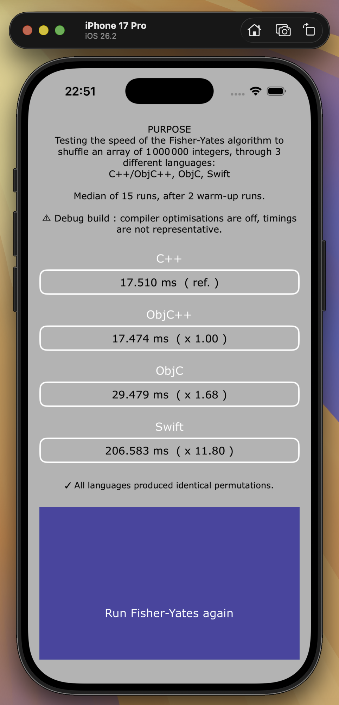
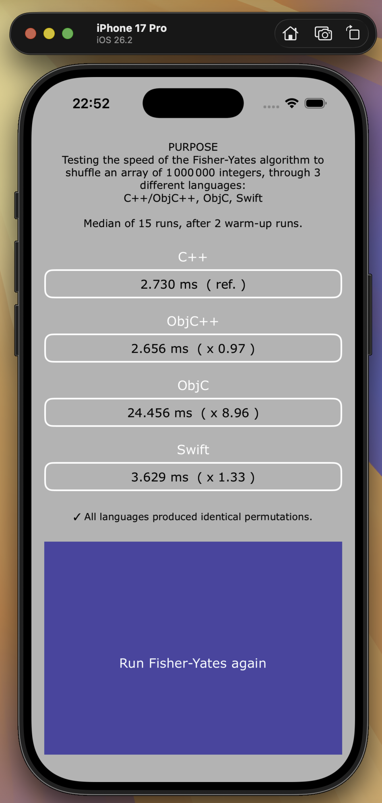

# SpeedEval

## Overview

An iOS app that measures how fast the same algorithm runs in **C++, Objective-C++, Objective-C and Swift**. Each language shuffles an array of **1,000,000 integers** with the [Fisher-Yates algorithm](https://en.wikipedia.org/wiki/Fisher%E2%80%93Yates_shuffle), and the app shows each one's time next to the C++ reference.

The project was first written in 2021 and reworked in October 2026 to make the measurements more reliable.

## Authors and contributors

| Topic | Sub-topic | Author/Contributor |
|---|---|---|
| Project management | JIRA | - |
| Project management | Versioning with Git | gk-solve |
| Functional design | | gk-solve |
| Technical architecture design | Pattern choice | gk-solve |
| Technical architecture design | Components and frameworks | gk-solve |
| Development | Code writing | gk-solve (2021) + Claude Code (2026) |
| Development | Code comments | Claude Code (2026) |
| Development | Cloud services set up | - |
| Testing | Test environment set up | gk-solve (2021) + Claude Code (2026) |
| Testing | Tests execution | gk-solve |
| Documentation | README file | Claude Code |

## What is compared

Each variant is written the way that language is normally written, using its usual data structures. Low-level rewrites, such as raw C arrays in Objective-C or unsafe pointers in Swift, are deliberately excluded.

| Variant | File | Storage |
|---|---|---|
| C++ (reference) | `Functions/NumbersSeriesCPP.cpp` | `std::vector<int>` |
| ObjC++ | `Functions/NumbersSeriesObjCPP.mm` | `std::vector<int>` |
| ObjC | `Functions/NumbersSeriesObjC.m` | `NSMutableArray` of `NSNumber` |
| Swift | `Functions/NumbersSeriesSwift.swift` | `[Int32]` |

**ObjC++ is a control.** Its code is identical to the C++ variant and both are compiled by the same clang. Any gap between the two is measurement noise, which shows how far the other gaps can be trusted.

Swift calls the C++ code through the Objective-C++ class `NumbersSeriesObjCPP`, which is exposed via the bridging header.

## Methodology

- **Same random numbers everywhere.** Every variant uses its own implementation of the same generator (SplitMix64). The system generators (`rand()`, `arc4random()`, `Int.random`) have very different costs that would otherwise dominate the timings.
- **Results are cross-checked.** For a given seed, all four variants must produce exactly the same permutation. The app compares a checksum of each result and displays ✓ or ⚠︎.
- **Same clock everywhere.** All variants use `clock_gettime_nsec_np(CLOCK_UPTIME_RAW)`, a monotonic clock, and nothing is logged inside the timed section.
- **Repeated runs.** The app runs 2 discarded warm-up rounds, then 15 measured rounds, and reports the median. The order of the variants is shuffled each round.
- **Timed work.** The timing covers building the array and shuffling it.
- **Off the main thread.** The benchmark runs on a background queue, so the interface stays responsive.
- **Array size.** At 100,000 elements, one C++ run took about 0.1 ms and varied up to tenfold between launches. At 1,000,000 elements, the results are stable.

## Results

Median time in milliseconds, with the ratio to C++ in parentheses. Measured in October 2026.

Test environment:

| | |
|---|---|
| iPhone | iPhone SE (2nd generation, A13 Bionic), iOS 26.6 |
| iOS Simulator | iPhone 17 Pro, iOS 26.2, on a Mac with Apple M2 running macOS Tahoe 26.2 |
| Xcode | 26.2 |

| Environment | C++ | ObjC++ | ObjC | Swift |
|---|---|---|---|---|
| iOS Simulator, Debug | 17.510 | 17.474 (×1.00) | 29.479 (×1.68) | 206.583 (×11.80) |
| iPhone, Debug | 24.519 | 24.740 (×1.01) | 30.201 (×1.23) | 347.628 (×14.18) |
| iOS Simulator, **Release** | 2.730 | 2.656 (×0.97) | 24.456 (×8.96) | 3.629 (×1.33) |
| iPhone, **Release** | 5.325 | 5.382 (×1.01) | 26.430 (×4.96) | **4.178 (×0.78)** |

In every run, all languages produced identical permutations, and ObjC++ stayed within 3% of C++.

The iOS Simulator runs in Debug (left) and Release (right). The Debug build shows its warning at the top:

<p align="center">
  
  &nbsp;&nbsp;
  
</p>

### Analysis

**Debug and Release builds give completely different rankings.** In Debug, compiler optimisations are off (`-O0` for C/C++, `-Onone` for Swift). Each language reacts differently when they are switched on (speed-up = Debug time ÷ Release time):

| | Simulator | iPhone |
|---|---|---|
| C++ | ×6.4 | ×4.6 |
| ObjC | ×1.2 | ×1.1 |
| Swift | ×57 | ×83 |

- **Swift depends most on the optimiser.** Arrays, `swapAt`, ranges and even the wrapping operators `&+` and `&*` are generic standard-library code. In Release, the compiler specialises this code for `Int32` and inlines it. In Debug, every operation is a real function call, often through protocol witness tables, with retain/release on each array access.
- **C++ gains less.** In Release, `std::vector::operator[]` and `std::swap` are inlined, so the shuffle loop compiles to a few instructions with no calls.
- **ObjC barely changes.** Its time is spent inside `NSMutableArray`, `NSNumber` and `objc_msgSend`. Apple ships that framework code already optimised, so the project's build settings do not affect it.

**In Release, ObjC is the slowest by far.** Language features are not the cause: Objective-C is a strict superset of C, and the same algorithm on a plain `int` array runs as fast as C++. The cost comes from boxing each integer into an `NSNumber` and sending a message for each access. That cost is part of what idiomatic Objective-C pays.

**ObjC's ratio varies (×5 to ×9) mostly because C++ varies.** ObjC itself stays between 24 and 26 ms on both the Simulator and the iPhone.

**On the iPhone in Release, Swift beat C++ (×0.78).** This did not happen on the Simulator or the Mac, and the cause is not established yet. Known factors:

- **Optimisation levels differ.** Xcode's Release configuration compiles C/C++ with `-Os` (optimise for size) and Swift with `-O` (optimise for speed). On a Mac (Apple M2), `-Os` makes the C++ variant about 20% slower than `-O2`. This explains part of the gap, not all of it.
- **Generated code is near-identical.** With optimisations on, Swift's shuffle loop compiles to almost the same machine code as the C++ one. Swift's bounds and copy-on-write checks cost little at this size.
- **Possible cause: memory initialisation (not verified).** `std::vector<int>(n)` zero-fills its 4 MB buffer before the fill loop writes it again, while Swift writes it only once. First-touch page faults may be more expensive on iOS devices. The iPhone SE's A13 chip also has smaller caches than the M2, which makes extra passes over memory relatively more expensive.

A Time Profiler trace in Instruments on the device (Product > Profile) would settle it.

## Running the benchmark

1. Open `SpeedEval.xcodeproj` in Xcode.
2. **Use a Release build for meaningful numbers.** Either:
   - choose **Product > Profile (⌘I)**, which always builds in Release, or
   - go to **Product > Scheme > Edit Scheme… > Run > Info > Build Configuration** and select **Release**.

   In Debug, the app shows the warning *"⚠︎ Debug build : compiler optimisations are off, timings are not representative."* If you see it, you are not measuring Release.
3. Tap **Run Fisher-Yates again** to repeat the measurement.

The iOS Simulator runs natively on the Mac's CPU and does not emulate iPhone hardware. Use a real device for representative numbers.

## Tests

`SpeedEvalTests` (⌘U) checks:

- each variant returns a valid permutation, including with 0, 1 and 2 elements;
- all four variants produce the same permutation from the same seed;
- the shuffle is uniform (each of the 6 orders of 3 elements shows up about 1/6 of the time);
- the benchmark reports every variant, and the median is computed correctly.

## Project layout

```
SpeedEval/
├── MainViewController.swift      Interface (Auto Layout, Dynamic Type) and display of results
├── App commons/                  AppDelegate, AppCommons singleton
├── Functions/
│   ├── Benchmark.swift           Warm-up, repeated rounds, median, checksum comparison
│   ├── NumbersSeriesCPP.hpp/.cpp C++ reference, SplitMix64, checksum
│   ├── NumbersSeriesObjCPP.h/.mm ObjC++ variant and bridge from Swift to C++
│   ├── NumbersSeriesObjC.h/.m    Objective-C variant
│   └── NumbersSeriesSwift.swift  Swift variant
├── Bridges/                      Bridging headers
└── App assets/                   Colours (light/dark), images, icon
SpeedEvalTests/                   Unit tests
```

Requires iOS 14.4 or later.

---

Copyright © 2021. All rights reserved.
